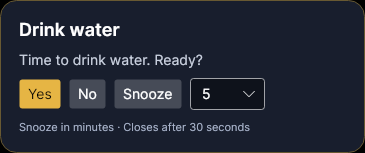

# Superstar Reminder

An animated desktop reminder app for **Windows and macOS**. A Jailer-inspired Superstar Rajinikanth character enters your primary screen, displays your reminder, and reacts to **Yes**, **No**, or **Snooze**.

Built with **C# / .NET 8, Avalonia UI, and local MySQL**. Character images were newly generated for this project; they are not film footage or an endorsement by the performer.



[View the dashboard](docs/screenshots/dashboard.png) · [Detailed setup](docs/SETUP.md) · [Validation results](docs/VALIDATION.md)

## 1. Download the application

You do **not** need Visual Studio, the .NET SDK, or a separate .NET runtime to run a prebuilt download. You **do** need a local MySQL server, configured in step 3.

Current downloads are development builds hosted in **GitHub Actions**, rather than signed installers or GitHub Releases.

1. Sign in to GitHub.
2. Open the [verified successful build](https://github.com/puneeee/superstar-reminder/actions/runs/38940348541), or go to [Actions → CI](https://github.com/puneeee/superstar-reminder/actions/workflows/ci.yml) and select a successful run for `main`.
3. Scroll to **Artifacts** and download the ZIP matching your computer:

| Your computer | Download artifact | Application file |
| --- | --- | --- |
| Windows, Intel/AMD 64-bit | `SuperstarReminder-win-x64` | `SuperstarReminder.exe` |
| Mac with Apple Silicon (M-series chip) | `SuperstarReminder-osx-arm64` | `SuperstarReminder` |
| Mac with an Intel processor | `SuperstarReminder-osx-x64` | `SuperstarReminder` |

On a Mac, **Apple menu → About This Mac** shows your chip or processor.

GitHub requires sign-in to download workflow artifacts. Artifacts expire according to the repository's retention policy; if an old download has expired, choose a newer successful build or use the source-build instructions below. See [GitHub's artifact download guide](https://docs.github.com/en/actions/how-tos/manage-workflow-runs/download-workflow-artifacts).

**Code → Download ZIP downloads the source code, not a ready-to-run application.** Use it only if you plan to build the app yourself.

## 2. Extract and launch

### Windows

1. Right-click the downloaded ZIP and select **Extract All**.
2. Extract the entire folder somewhere permanent, for example `D:\SuperstarReminder\app`.
3. Open the extracted folder and double-click **SuperstarReminder.exe**.

Keep the executable, DLLs, `db`, and `Assets` folders together. Do not run the executable from inside the ZIP or copy only the EXE elsewhere.

The app initially shows **MySQL setup required**. Complete the database setup below before saving reminders. **Preview character** works without a database.

### macOS

1. Download the artifact matching your Mac, then extract the ZIP.
2. Keep the entire extracted application folder in a permanent location.
3. Open Terminal, type `cd `, drag the extracted folder into Terminal, and press Return.
4. Run:

```sh
chmod +x ./SuperstarReminder
./SuperstarReminder
```

The current download is an executable folder, not a signed/notarized `.app` or `.dmg` installer. macOS security controls may prevent launching an unsigned download. A source-build option is provided below. Keep the published executable in the same location after enabling launch at login.

## 3. Install MySQL and create the database

This app stores reminders and history in **MySQL running on your own computer**. It does not install MySQL automatically. Keep the MySQL service running while using reminders.

1. Download [MySQL Community Server](https://dev.mysql.com/downloads/mysql/). **MySQL 8.4 LTS** is the version used by the live CI integration checks.
2. Install and start the server locally. Use port `3306` unless you need another port. On Windows, you can save the installer on D: and choose your installation/data locations in the MySQL setup tools.
3. Open the MySQL command-line client or MySQL Workbench and connect using your database administrator account. For a command-line client available on your PATH:

```sh
mysql -u root -p
```

Enter your administrator password when prompted. Run this SQL **once**, replacing the example password with a strong password of your own:

```sql
CREATE DATABASE superstar_reminder
  CHARACTER SET utf8mb4 COLLATE utf8mb4_unicode_ci;

CREATE USER 'superstar_app'@'127.0.0.1'
  IDENTIFIED BY 'REPLACE_WITH_YOUR_OWN_STRONG_PASSWORD';

GRANT SELECT, INSERT, UPDATE, DELETE, CREATE, ALTER, INDEX, REFERENCES
  ON superstar_reminder.* TO 'superstar_app'@'127.0.0.1';
```

This creates a dedicated application account with access to its own database. The schema privileges allow the app to apply versioned migrations. **Use `superstar_app` in the app, not `root`.** The Settings screen rejects root logins.

The app creates its tables automatically after connecting. You do not need to apply the SQL files in `db/` manually.

## 4. Connect the app to MySQL

Open **Settings** and enter:

| Setting | Value |
| --- | --- |
| MySQL server | `127.0.0.1` |
| Port | `3306`, or the port you configured |
| Database | `superstar_reminder` |
| Application user | `superstar_app` |
| Password | The application password you chose in step 3 |

Click **Test connection & save**. After migrations finish, the dashboard should report that it is connected to MySQL.

The login is protected with your Windows user account through DPAPI, or stored in macOS Keychain. Preferences and selected audio stay in your per-user application data directory. V1's Settings screen accepts a local database server only.

## 5. Create your first reminder

1. Click **+ New reminder**.
2. Enter a **title** and **message**, for example `Drink water` and `Time to drink water. Ready?`.
3. Choose a schedule:

| Schedule | How it works |
| --- | --- |
| `OneTime` | Fires once at the selected future date and time |
| `Daily` | Repeats at the selected local time each day |
| `Weekdays` | Repeats at the selected time on the weekdays you check |
| `Interval` | Repeats every X minutes, anchored to the selected start time |

4. Select a start date/time. For a quick test, choose **OneTime about two minutes in the future**.
5. Optionally enable **Limit to active hours**. Ranges may cross midnight, such as 22:00–06:00. A one-time reminder must be inside its selected active hours.
6. Optionally choose a local **WAV or MP3** arrival clip, up to 25 MB. The app copies it into its managed media folder. Default is silent.
7. Leave **Enabled** checked and click **Save reminder**.
8. Use **Preview character** to check the animation; preview responses do not change history.

When the reminder appears:

| Action | Result |
| --- | --- |
| **Yes** | Records acknowledgement, celebrates, and runs across the display |
| **No** | Skips this occurrence and walks back to the nearby edge |
| **Snooze** | Uses the selected 5/10/20/30-minute delay and walks back |
| No response for 30 seconds | Records unanswered and takes the short exit |

Recurring reminders keep their normal cadence after a response. An explicit Snooze may fire outside active hours. Yes acknowledges the prompt; it does not verify that the activity was performed.

## 6. Everyday use

- **Edit / Enable / Disable / Delete:** select a reminder and use the buttons below the list. Delete retains its response history.
- **Response history:** review outcomes and filter by title or outcome.
- **Settings:** choose a character, bottom-left or bottom-right placement, character height, and optional **Start at login**. The primary monitor is used automatically.
- **Pause reminders:** pauses scheduling until you resume it.
- **Close the dashboard:** reminders keep running in the Windows tray or macOS menu bar. Click the tray icon or use **Open reminders** to reopen it.
- **Quit application:** stops reminders completely. Restart the app to resume them.
- **Lock / sleep / fullscreen:** the app attempts to defer interruptions and groups missed reminders into a catch-up summary/history entry.

## Troubleshooting

| Problem | What to check |
| --- | --- |
| Artifact download is unavailable | Sign in to GitHub; choose a successful run with unexpired artifacts |
| The EXE is missing after downloading | Download the platform artifact, not **Code → Download ZIP** |
| App fails after moving the EXE | Extract the complete ZIP again; keep DLLs, `db`, and `Assets` beside the executable |
| MySQL connection fails | Start the local MySQL service; verify server, port, database, username, and password in Settings |
| MySQL code `1045` | Check the dedicated account's password and allowed host; use the configured `127.0.0.1` account |
| MySQL code `1049` | Create the `superstar_reminder` database using step 3 |
| Tables/migrations cannot be created | Check the dedicated account has the listed schema privileges on `superstar_reminder.*` |
| A reminder does not appear | Check Enabled, pause state, start time, weekdays, and active hours; fullscreen/lock can defer presentation |
| There is no sound | Audio is silent by default; select a WAV/MP3 in the reminder editor and check system volume |
| Dashboard disappears after closing | This is close-to-tray behavior; reopen it from the tray/menu bar |

If MySQL becomes unavailable, the app reports the failure and retains pending response writes for retry. Reopen the app after restoring the service if necessary.

## Build from source (optional)

Use this route to develop the app or rebuild an expired artifact. It requires the **.NET 8 SDK** and local MySQL. A prebuilt download does not require the SDK.

Clone the repository, or download/extract **Code → Download ZIP**:

```sh
git clone https://github.com/puneeee/superstar-reminder.git
cd superstar-reminder
```

### Windows: SDK, downloads and app on D:

From the repository folder, run:

```powershell
powershell -File .\scripts\setup-windows.ps1
```

The script downloads Microsoft's SDK installer to `D:\SuperstarReminder\downloads`, installs the SDK and NuGet cache beneath `D:\SuperstarReminder\tools`, runs scheduling checks, and publishes the app to `D:\SuperstarReminder\app`. It does not provision MySQL. D: must exist; alternatively pass `-InstallRoot` with another existing drive.

### macOS or an existing SDK installation

```sh
dotnet restore SuperstarReminder.sln
dotnet build SuperstarReminder.sln -c Release
dotnet run --project src/SuperstarReminder
```

Create a self-contained folder for the appropriate target:

```sh
# Windows x64
dotnet publish src/SuperstarReminder -c Release -r win-x64 --self-contained true -o artifacts/win-x64

# macOS Apple Silicon
dotnet publish src/SuperstarReminder -c Release -r osx-arm64 --self-contained true -o artifacts/osx-arm64

# macOS Intel
dotnet publish src/SuperstarReminder -c Release -r osx-x64 --self-contained true -o artifacts/osx-x64
```

Run the application file inside the published folder, then complete steps 3–5 above.

### Automated checks

```sh
dotnet run --project tests/SuperstarReminder.Tests
dotnet run --project tests/SuperstarReminder.UiTests
```

Database checks additionally require `SUPERSTAR_MYSQL_TEST_CONNECTION` pointing to a disposable database whose name ends in `_test`:

```sh
dotnet run --project tests/SuperstarReminder.DatabaseTests
```

## Status and project information

Windows x64, macOS Apple Silicon, macOS Intel, and MySQL CI jobs have passed, covering **51 distinct automated checks**. Read [the validation record](docs/VALIDATION.md) for evidence and remaining acceptance work.

This is an unsigned development build. Native click-through/focus, fullscreen/Spaces transitions, notifications, audio, startup and display scaling still need hands-on desktop acceptance testing. Signed installers and macOS notarization are not included. Generated character loops also need motion review.

| Path | Contents |
| --- | --- |
| `src/SuperstarReminder` | App, scheduling, overlay, editor, settings and platform integration |
| `db` | MySQL migrations |
| `tests` | Scheduling, headless UI and live database checks |
| `scripts` | Windows setup and authenticated repository publishing helpers |
| `docs` | Setup, character packages, screenshots and validation |

See [V1 plan](V1-plan.md), [character packages](docs/CHARACTERS.md), [contribution guide](CONTRIBUTING.md), and [security policy](SECURITY.md).
